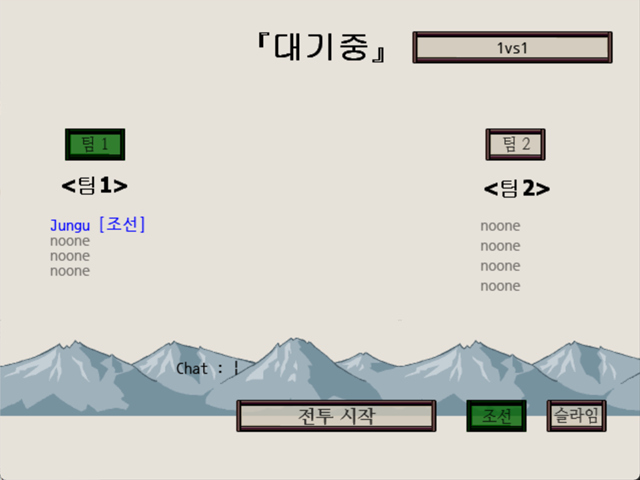
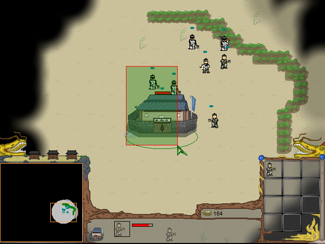

# Myth of Legend 2

[한국어](README.ko.md)

Myth of Legend 2 (Korean subtitle 전쟁의서막) is a real-time strategy game made in GameMaker 8. Pick one of two races, Joseon or Slime, gather resources, put up buildings, train units, and fight. It supports multiplayer up to 2v2 with spectators, and single player against the computer. Unit stats and graphics live in text and sprite files outside the executable, so editing those files is enough to change a unit or add a new one. It is the sequel to [Myth of Legend](https://github.com/wnsrn3436/game-myth-of-legend).

<p>


</p>


## How to play

Download the game from Releases and run it. On the first screen, host a game, join someone else's game by entering an IP, or choose single player. A game opens on port 12345, and you enter a name when joining. In the lobby you pick a team, a race (Joseon or Slime), and a map (1vs1 or 2vs2), and you can chat. Pressing start begins the game for everyone 5 seconds later. Each team has four slots, and slots without a start point on the map become spectators. Single player asks for a race and a computer difficulty (1 to 5).

| Control | Action |
|---|---|
| Left drag | Select units (up to 8 at a time) |
| Double click a unit | Select nearby units of the same kind (up to 8) |
| Right click | Move. With a single production building selected, sets its rally point |
| A then left click | Attack move |
| 1 to 9 | Production hotkeys. ESC cancels the last queued item |
| Q | Send a worker to gather |
| Arrow keys, mouse at the screen edge | Scroll the view |
| Enter | Chat. Typing `!name` renames the selected units |
| Minimap | Left drag scrolls the view, right click gives a move order |

In single player, typing `백만장자` in chat gives 5000 resources and `내눈을바라봐` lifts the fog. The production queue holds up to 6 items, and workers slowly lose HP while gathering. Spearmen get bonus damage against cavalry and Genes, and horse archers and Limests get bonus damage against buildings. View scroll speed and fog quality are set in `Options.ini`.


## How it works

**Stats and graphics live outside the executable.** At startup the game reads every `Abilitys\<id>.txt`, and stores its `key=value` lines, in order, in `global.abilitys[id, n]` (the name line is kept separately). `Costs.txt`, `Times.txt`, and `Moni_Go.txt` hold production costs, production times, the resource drop-off buildings, and the HP loss while gathering as plain GML statements, and the game runs them with `execute_file`. Unit graphics are `Sprites\<id>_<n>.gmspr` files loaded with `sprite_add_sprite`. IDs 0 to 9 are Joseon and 100 to 111 are Slime.

```gml
execute_file("Abilitys\Costs.txt")
execute_file("Abilitys\Times.txt")
execute_file("Abilitys\Moni_Go.txt")
```

That is why editing the files is enough to change or add units. However, right after connecting, the game takes one MD5 over the executable and every file in `Abilitys\` and `Sprites\` and compares it with the host's. If they differ, it shows a message and ends the game.

**Multiplayer replicates actions.** The game wraps Faucet Networking sockets with FN Simple Scripts v3.2, written by the author, and sends every action such as moving, attacking, producing, or taking damage as a numbered message. Units and buildings get a serial number from the host when created and are rebroadcast to everyone, so every screen refers to the same unit by the same number. The owner of the attacking unit computes the damage and sends only the result, and the host does this for computer units. The computer opponent runs on four alarms for worker production, unit production, construction, and attacks, and the difficulty level divides the alarm periods.

**Korean text and input bypass the engine.** GameMaker 8 cannot draw Korean properly and cannot receive characters while they are being composed. So text is drawn with a sprite font script, and chat input reads the IME composition string through K-DLL, also written by the author. Fog of war stamps sight into a `ds_grid`, copies it to a screen-sized surface, and covers the view with subtractive blending.


## Files

| Path | Content |
|---|---|
| `source/myth-of-legend-2.gmk` | Project file |
| `source/split/` | Text tree produced by GmkSplitter |
| `source/Abilitys/` | Text files for unit stats and production costs and times |
| `source/Sprites/` | Unit sprites (`<id>_<n>.gmspr`) |
| `source/Gex/` | Extension packages |
| `source/ICO/` | Icon and loading image |
| `source/Options.ini` | View scroll speed and fog quality settings |
| `old/2009-11-prototype/` | Engine testbed that reads unit graphics from password-protected zips |
| `old/2009-12-planning/` | Fog demo, terrain editor, map editor, and the design notes for a homemade dlrc archive |
| `old/2010-02-dongto-yeomyeong/` | The predecessor 동토의 여명: source of the 39dll multiplayer build and a decompiled v1.2 executable |
| `docs/old-versions.md` | How the earlier versions relate |
| Releases | Executable, data files, and background music |


## Credits

쉐라프 (zizonpink) drew the unit pixel art. Faucet Networking is by Medo42, 39DLL by 39ster, Saudio by andrewmc, Hashes Dll by freaked, and the Korean text rendering script (Sefx) by 김게맛 (sodium031). The prototype uses gmZip.dll (`ml_uns.dll` is the same file) for zip handling. InstanceNearest, K-DLL, FN Simple Scripts, and 39dll Simple Scripts are the author's own.


## License

CC BY-NC-ND 4.0. Unmodified copies may be shared for noncommercial purposes with attribution. Modified versions and commercial use are not allowed. Bundled libraries, graphics, sounds, and maps made by other people keep their own rights. See [LICENSE](LICENSE).
